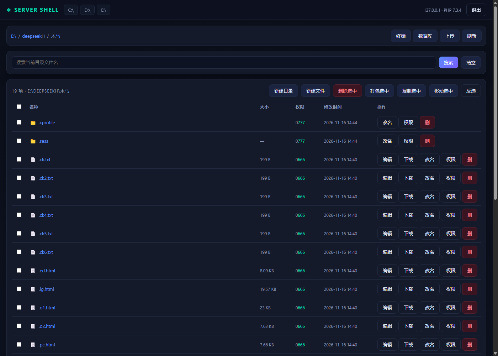
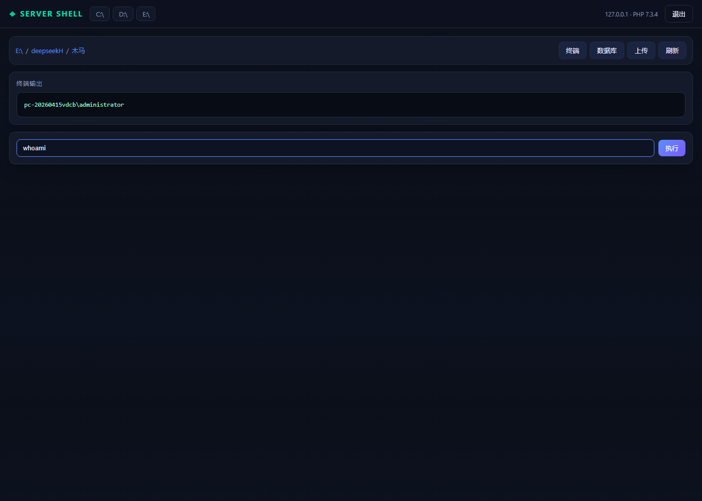

# Server Shell

一个 PHP 单文件服务器管理面板：文件浏览 / 跨盘跳转 / 在线编辑 / 命令执行 / MySQL 查询 / 批量上传打包。

> 仅供自有服务器运维、靶场和本地实验环境使用。默认密码务必先改。

默认口令：`admin888`（源码第 12 行 `define('PASS', 'admin888');`）

## 文件

| 文件 | 说明 |
| --- | --- |
| `super.php` | 完整面板，主推。44KB 单文件，无外部依赖，PHP 7.x 实测通过 |
| `big.php` | 轻量前任，文件管理 + 上传 + 命令，无登录，功能少 |
| `small.php` | 小马，`system` 执行 + 单文件上传表单 |
| `one.php` | 一行 `eval`，用于客户端连接调试 |

## 快速使用

```bash
# 本地起一个测试服务
php -S 127.0.0.1:9098 -t .

# 打开
# http://127.0.0.1:9098/super.php  密码 admin888
```

## 功能

- **盘符切换**：Windows 自动枚举 `C:\ ~ Z:\`，Linux 列出 `/`、`/mnt`、`/media` 等挂载点
- **自由跳转**：地址栏输入 `C:\Windows\Temp`、`/var/www`、`~` 均可解析，带 `../` 归一化
- **历史记录**：session 保存最近 15 个访问过的目录，一键回跳
- **文件操作**：新建目录/文件、改名、chmod、复制、移动、递归删除、多选批量、zip 打包/解包
- **在线编辑**：源码编辑（>2MB 拦截）、十六进制视图（前 8KB）
- **终端**：`shell_exec → popen → exec → system` 四级降级，禁函数时给出提示
- **PHP 执行**：独立代码框，`eval` 包 `Throwable`
- **数据库**：mysqli 连接 MySQL，SQL 结果表格化
- **远程下载**：URL 直链落当前目录
- **状态面板**：磁盘剩余/总量、可写性、PHP 版本、禁用函数列表

## 截图




## 改密码

```php
define('PASS', '你的新密码');   // super.php 第 12 行
```

登录页底部出现「默认密码未改」提示，说明口令还是初始值。

## 安全须知

- 只走 POST 提交文件操作，视图页（edit/cmd/db）在白名单内放行，防止误跳
- 密码存 session，不进 URL / 访问日志
- 没有内置 CSRF 校验，不要长期挂在公网
- 上传文件会落到当前目录并保留原权限，记得清理

## 环境

- PHP >= 7.3（7.3.4 实测），需 `mysqli` 与 `ZipArchive` 扩展；命令执行依赖 `shell_exec` 族
- Windows / Linux 均可

## License

MIT
